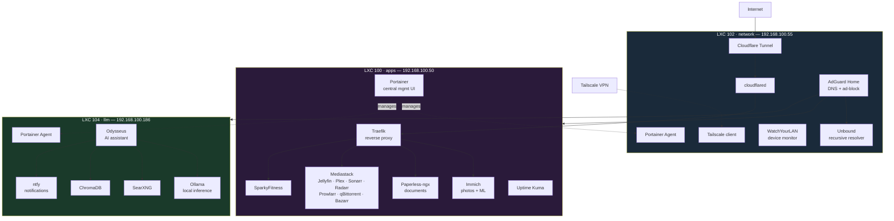

# Homelab
 
A self-hosted stack handling photo management, document archiving, media automation, network-wide DNS filtering, a VPN, fitness tracking, local LLM and expanding.
 
This repository stores the configuration files. A cron job runs `scripts/backup-configs.sh` on the Proxmox host to pull live configs from each LXC and push updates here automatically.
 
---
 
## Hardware & Host
 
* **CPU:** Intel Core i3-6100 (2 cores / 4 threads)
* **RAM:** 16 GB
* **Hypervisor:** Proxmox VE
* **Storage:** ZFS pool for app data, 4TB HDD for media
* **Containers:** 3 unprivileged Debian LXCs running Docker (everything runs in Docker inside LXC containers to keep overhead low)
---
 
## Architecture
 

 
* **DNS:** All containers resolve through AdGuard Home, which forwards queries to Unbound.
* **Ingress:** External access routes through a secure Cloudflare Tunnel straight to Traefik. No router ports are exposed.
* **Admin Access:** Tailscale is utilized as a secure private mesh VPN for remote management.
* **Container Management:** Portainer runs centrally in the Apps LXC and manages lightweight agents deployed in the Network and LLM LXCs, giving a single-pane view across all three hosts.
---
 
## Services
 
| Service | Purpose | LXC Container |
| :--- | :--- | :--- |
| **AdGuard Home** | DNS filtering / Ad-blocking | Network (102) |
| **Unbound** | Recursive DNS resolver | Network (102) |
| **Cloudflare Tunnel** | Public access without open ports | Network (102) |
| **Tailscale** | Private mesh VPN | Network (102) |
| **WatchYourLAN** | Network device monitoring | Network (102) |
| **Traefik** | Reverse proxy | Apps (100) |
| **Immich** | Photo & video backup | Apps (100) |
| **Paperless-ngx** | Document archiving & OCR | Apps (100) |
| **Jellyfin / Plex** | Media servers | Apps (100) |
| **Servarr Stack** | Media grabbers (Sonarr, Radarr, Prowlarr, Bazarr) | Apps (100) |
| **qBittorrent** | Torrent client | Apps (100) |
| **SparkyFitness** | Self-hosted fitness & nutrition tracking | Apps (100) |
| **Uptime Kuma** | Status monitoring | Apps (100) |
| **Portainer** | Central Docker management UI | Apps (100) |
| **Odysseus** | AI chat interface | LLM (104) |
| **Ollama** | Local LLM runner | LLM (104) |
| **SearXNG** | Search engine for LLM | LLM (104) |
| **ChromaDB** | Vector database for RAG | LLM (104) |
| **ntfy** | Push notifications | LLM (104) |
| **Portainer Agent** | Remote management endpoint | Network (102), LLM (104) |
| **Watchtower** | Automated container updates | All Containers |
 
---
 
## File Structure
 
```plaintext
homelab/
├── lxc-network/            # LXC 102 configs
│   ├── adguard/
│   ├── cloudflare/
│   ├── portainer/
│   ├── tailscale/
│   ├── unbound/
│   ├── watchtower/
│   └── wyl/
├── lxc-apps/                # LXC 100 configs
│   ├── immich/
│   ├── mediastack/
│   ├── paperless/
│   ├── portainer/
│   ├── sparkyfitness/
│   ├── traefik/
│   ├── uptimeKuma/
│   └── watchtower/
├── lxc-llm/                 # LXC 104 configs (Ollama, Odysseus stack)
├── pve-configs/
│   └── lxc/                 # 100.conf, 102.conf, 104.conf
└── scripts/
    └── backup-configs.sh    # The automation script
```
 
---
 
## Secrets & Security
 
* **Zero-Credential Commits:** No passwords, API keys, or security tokens are stored in this public-facing repository.
* **Environment Variables:** All sensitive values are sequestered in `.env` files which are globally ignored by Git. Only `.env.example` boilerplate templates are tracked.
* **Pre-push Auditing:** The automated backup script runs `gitleaks` locally prior to making any commits to catch accidentally exposed credentials.
---
 
## Automation (Backup Script)
 
The `/root/homelab-git/scripts/backup-configs.sh` script runs nightly via cron directly on the Proxmox host:
 
1. Runs `git pull` to pull down any remote adjustments.
2. Copies active configuration files from all three LXCs using Proxmox's `pct pull` utility, organized into per-container sections for clarity (Network, Apps, LLM).
3. Checks for accidentally leaked secrets using `gitleaks`.
4. Executes a `git commit` and `git push` back to the repository **only** if changes are detected.
The script currently syncs 20+ config files across every running service — from DNS resolvers to the AI assistant stack — so the repo stays a live mirror of the host rather than a stale export.
 
---
