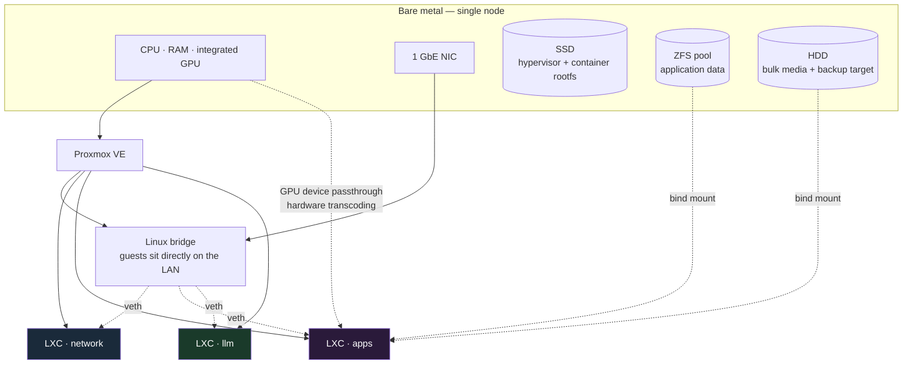
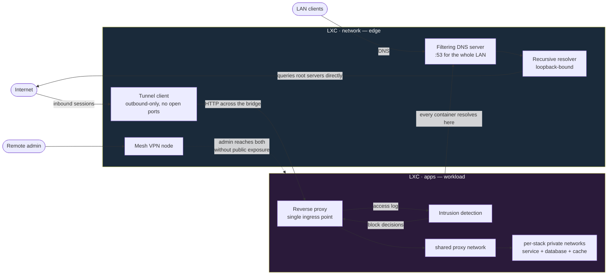
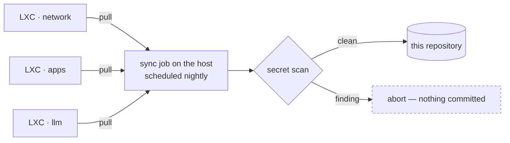

# Architecture Overview

A role-level view of the host and how the two long-running LXCs divide
responsibility. Individual services are listed in the [main README](../README.md);
this document is about the shape of the system, not its contents.

---

## 1. The host

One bare-metal node running Proxmox VE. Everything else is an unprivileged
Debian LXC with Docker inside it — no full VMs, so there is no second kernel or
guest memory reservation to pay for.

Guests are bridged rather than NATed, so each one holds its own static LAN
address and is reachable without hairpinning through the host.

Storage is split by access pattern rather than by owner: the SSD carries the
hypervisor and the container root filesystems, a ZFS pool carries application
state that benefits from checksums and snapshots, and a large HDD carries bulk
media plus the backup target — it can idle and spin down without stalling
anything interactive.

---

## 2. How the two LXCs interact

The split is deliberate: **network** is the edge and **apps** is the workload.
Nothing in the apps container talks to the internet directly, and nothing in the
network container stores application state.

Four things cross the boundary between them, and only four:

| Direction | What crosses | Why |
| :--- | :--- | :--- |
| network → apps | Inbound HTTP from the tunnel | The tunnel client terminates outside, then hands plain HTTP to the reverse proxy over the LAN bridge. |
| apps → network | DNS queries | Every container inherits the filtering resolver, so blocklists and query logs cover the whole estate, not just browsers. |
| network → both | Mesh VPN reachability | Admin interfaces are never published through the tunnel; they are reached over the VPN only. |
| apps → network | Management agent traffic | A single container-management UI in apps drives lightweight agents in the other LXCs, giving one pane across all three. |

Inside apps, the reverse proxy is the only container on both the shared proxy
network and the outside world. Each application stack keeps its database and
cache on a private network of its own, so a compromised front end cannot reach
another stack's data store.

The reverse proxy and the intrusion-detection service form a closed loop: the
proxy writes structured access logs to a shared volume, the IDS reads them and
scores the traffic, and the proxy queries it back on every request to decide
whether to serve or drop.

---

## 3. Startup order

Ordering is explicit rather than incidental. The apps container resolves registry
and API hostnames as soon as Docker starts, so the edge container has to be
answering DNS before it comes up — otherwise the first minute after every reboot
is a wave of resolution failures and restart backoff.

---

## 4. Configuration flow

The host pulls live configuration out of each container on a schedule and
commits it here. The repository is a **mirror, not a deployment source** — edits
land on the running containers first, and the sync catches up.

Application data is backed up separately and never enters this repository:
the ZFS pool replicates to the bulk HDD on its own schedule, with database
dumps taken from inside the running containers.
